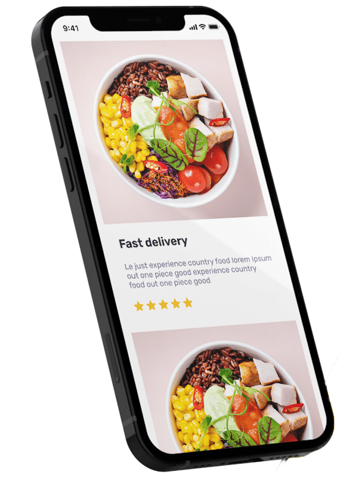

# BBQ Bites: Integrated Project Report

## 1. Introduction
The BBQ Bites project is a dynamic web-based food ordering application designed to provide users with a smooth and efficient online food purchasing experience. The application combines a responsive front-end interface with a Python Flask backend and a SQLite database, creating a complete system for menu browsing, cart management, order processing, and admin monitoring.

The project was developed to demonstrate real-world web application functionality and to integrate multiple technologies into a single working system. It highlights the importance of user interface design, JavaScript-based client-side interactivity, secure backend processing, and data persistence.

---

## 2. Project Objectives
The main objectives of the project were to:

- design a modern restaurant landing page for a food business;
- display food items in an attractive and structured menu layout;
- allow users to add items to the shopping cart and modify quantities;
- calculate totals dynamically and support order checkout;
- provide a functional backend to store and manage user transactions;
- protect admin routes with login verification;
- store orders, customer messages, and subscriptions in a database;
- develop a complete project suitable for academic reporting and demonstration.

---

## 3. Web Application Architecture
The project follows a three-layer architecture:

1. Front-end Layer: HTML, CSS, and JavaScript are used to create the interface and user interactions.
2. Application Layer: Python Flask is used to manage server-side logic and API routes.
3. Data Layer: SQLite stores orders, customer information, contact messages, and newsletter subscribers.

This structure effectively demonstrates how client-side and server-side technologies interact in a modern web application.

---

## 4. Front-End Development
The front-end is implemented using [index.html](index.html), [style.css](style.css), and [main.js](main.js). The homepage contains the main navigation bar, hero section, services section, menu cards, cart section, reviews, newsletter section, and footer.

### 4.1 Homepage Structure
```html
<!DOCTYPE html>
<html lang="en">

<head>
  <meta charset="UTF-8" />
  <meta name="viewport" content="width=device-width, initial-scale=1.0" />
  <title>Foodie Website</title>
  <link rel="stylesheet" href="https://cdnjs.cloudflare.com/ajax/libs/font-awesome/7.0.1/css/all.min.css"
    integrity="sha512-2SwdPD6INVrV/lHTZbO2nodKhrnDdJK9/kg2XD1r9uGqPo1cUbujc+IYdlYdEErWNu69gVcYgdxlmVmzTWnetw=="
    crossorigin="anonymous" referrerpolicy="no-referrer" />
  <link rel="stylesheet" href="https://cdn.jsdelivr.net/npm/swiper@11/swiper-bundle.min.css" />
  <link rel="stylesheet" href="style.css" />
</head>

<body>
  <header>
    <nav class="navbar flex between wrapper">
      <a href="#" class="Logo">BBQ Bites</a>

      <ul class="navlist flex gap-3">
        <li><a href="index.html">Home</a></li>
        <li><a href="#menu">Menu</a></li>
        <li><a href="#services">Services</a></li>
        <li><a href="about.html">About us</a></li>
        <li><a href="contact.html">Contact us</a></li>
      </ul>

      <div class="desktop-action flex gap-2">
        <a href="#" class="cart-icon">
          <i class="fa-solid fa-bag-shopping"></i>
          <span class="cart-value">0</span>
        </a>

        <a href="login/login.html" class="btn">
          Sign in
          <i class="fa-solid fa-arrow-right-to-bracket"></i>
        </a>

        <a href="#" class="hamburger">
          <i class="fa-solid fa-bars"></i>
        </a>
      </div>

      <ul class="mobile-menu">
        <li><a href="index.html">Home</a></li>
        <li><a href="#menu">Menu</a></li>
        <li><a href="#services">Services</a></li>
        <li><a href="about.html">About us</a></li>
        <li><a href="contact.html">Contact us</a></li>
      </ul>
    </nav>
  </header>

  <main>
    <section>
      <div class="hero-section flex between wrapper">
        <div class="content">
          <h1>
            Enjoy Your Delicious BBQ Meals
            <span>With Family</span>
          </h1>
          <p class="para">We will Fill Your Tummy With Delicious <br>Food With Fast delivery</p>
          <div class="flex">
            <a href="#menu" class="btn">Order Now</a>
          </div>
        </div>
        <div class="image-container">
          
        </div>
      </div>
    </section>

    <section id="services">
      <div class="p-top wrapper">
        <div class="text-center">
          <h5>Our Services</h5>
          <h2>How Does it Work?</h2>
        </div>

        <div class="flex text-center mt-4 gap-4">
          <div class="service-card">
            <div class="image-container">
              
            </div>
            <h3>Easy to Order</h3>
            <p>You Only Need A Few Steps in Ordering Food</p>
          </div>

          <div class="service-card">
            <div class="image-container">
              
            </div>
            <h3>fast Delivery</h3>
            <p>Delivery That Is Alwyas Ontime And Even Faster</p>
          </div>

          <div class="service-card">
            <div class="image-container">
              
            </div>
            <h3>Best Quality</h3>
            <p>Not Only fast Food For Us In Quality Is Also Number One</p>
          </div>
        </div>
      </div>
    </section>

    <section id="menu">
      <div class="wrapper p-top">
        <div class="text-center">
          <h5>Our Menu</h5>
          <h2>The Most Popular</h2>
        </div>

        <div class="card-list text-center flex mt-4 gap-4"></div>

        <div class="cart-tab">
          <h3>Your Cart</h3>
          <div class="cart-list"></div>

          <div class="total-container">
            <h4>Total:</h4>
            <h4 class="cart-total">$0.00</h4>
          </div>

          <div class="btn-container flex gap-2">
            <a href="" class="btn close-btn">Close</a>
            <a href="checkout/checkout.html" class="btn checkout-btn">Check out</a>
          </div>
        </div>
      </div>
    </section>

    <section>
      <div class="wrapper p-top flex gap-3">
        <div class="image-container">
          
        </div>

        <div class="review-container">
          <h5>Our Reviews</h5>
          <h2>What they say?</h2>

          <div class="swiper mySwiper">
            <div class="swiper-wrapper mt-4">
              <div class="swiper-slide">
                <div class="flex gap-2 ">
                  <div class="profile">
                    
                  </div>
                  <div>
                    <h4>John Doe</h4>
                    <div class="mt-half">
                      <i class="fa-solid fa-star"></i>
                      <i class="fa-solid fa-star"></i>
                      <i class="fa-solid fa-star"></i>
                      <i class="fa-solid fa-star"></i>
                    </div>
                  </div>
                </div>
                <p class="para">Foodie is the best. Besides the many delicious meals,
                  the service is also very good, especially very fast
                  delivery. I highly recommend Foodie to you.</p>
              </div>

              <div class="swiper-slide">
                <div class="flex gap-2 ">
                  <div class="profile">
                    
                  </div>
                  <div>
                    <h4>Sophia Anderson</h4>
                    <div class="mt-half">
                      <i class="fa-solid fa-star"></i>
                      <i class="fa-solid fa-star"></i>
                      <i class="fa-solid fa-star"></i>
                      <i class="fa-solid fa-star"></i>
                    </div>
                  </div>
                </div>
                <p class="para">Fresh ingredients, creative menu, and warm service
                  make this spot a hidden gem. Perfect for casual dinners
                  or special nights out. Truly a foodie’s paradise!</p>
              </div>

              <div class="swiper-slide">
                <div class="flex gap-2 ">
                  <div class="profile">
                    
                  </div>
                  <div>
                    <h4>Olivia Smith</h4>
                    <div class="mt-half">
                      <i class="fa-solid fa-star"></i>
                      <i class="fa-solid fa-star"></i>
                      <i class="fa-solid fa-star"></i>
                      <i class="fa-solid fa-star"></i>
                    </div>
                  </div>
                </div>
                <p class="para">Delicious dishes, cozy ambiance, and exceptional service.
                  A must-visit for food lovers seeking bold flavors and
                  unforgettable dining experiences. Highly recommended,
                  every bite delights!</p>
              </div>
            </div>

            <div class="flex between">
              <a href="" class="arrow" id="prev">
                <i class="fa-solid fa-arrow-left"></i>
              </a>
              <a href="" class="arrow" id="next">
                <i class="fa-solid fa-arrow-right"></i>
              </a>
            </div>
          </div>
        </div>
      </div>
    </section>

    <section>
      <div class="wrapper p-top">
        <div class="app-container flex gap-3">
          <div class="image-container">
            
          </div>
          <div class="content">
            <h5>Our Application</h5>
            <h2>Simple Way To <br>Order Your Food</h2>
            <p class="para">Discover food wherever and whenever <br>
              and get your food delivery quickly.</p>
            <a href="#" class="btn">Get The App</a>
          </div>
        </div>
      </div>
    </section>

    <section>
      <div class="wrapper p-top">
        <div class="text-center">
          <h5>Our Subscribe</h5>
          <h2>Subscribe To Our Newsletter</h2>
          <p class="para m-auto">
            We recommend you to subscribe our newspaper, drop your email below to get daily update about us.
          </p>
          <form id="newsletter-form" class="input-container flex">
            <input type="email" id="subscriber-email" placeholder="Enter your email" autocomplete="off" required />
            <button type="submit" class="btn" style="border: none; cursor: pointer;">Subscribe</button>
          </form>
        </div>
      </div>
    </section>
  </main>

  <footer>
    <div class="footer-container">
      <div class="flex wrapper gap-4">
        <div class="footer-warrper ">
          <a href="" class="Logo">BBQbites</a>
          <p class="mt-one-half">We will Fill Your Tummy With Delicious <br>Food With Fast delivery</p>

          <div class="flex gap-2 mt-one-half">
            <a href="#" class="social-icon"><i class="fa-brands fa-x-twitter"></i></a>
            <a href="#" class="social-icon"><i class="fa-brands fa-instagram"></i></a>
            <a href="#" class="social-icon"><i class="fa-brands fa-facebook-f"></i></a>
            <a href="#" class="social-icon"><i class="fa-brands fa-google-plus-g"></i></a>
          </div>
        </div>

        <ul class="footer-warrper">
          <li><h4>Our Menu</h4></li>
          <li class="mt-one-half"><a href="" class="footer-link">Special</a></li>
          <li class="mt-one-half"><a href="" class="footer-link">Popular</a></li>
          <li class="mt-one-half"><a href="" class="footer-link">Category</a></li>
        </ul>

        <ul class="footer-warrper">
          <li><h4>Company</h4></li>
          <li class="mt-one-half"><a href="" class="footer-link">why BBqbites</a></li>
          <li class="mt-one-half"><a href="" class="footer-link">Partner With us</a></li>
          <li class="mt-one-half"><a href="about.html" class="footer-link">About us</a></li>
          <li class="mt-one-half"><a href="" class="footer-link"> FAQ</a></li>
        </ul>

        <ul class="footer-warrper">
          <li><h4>Support</h4></li>
          <li class="mt-one-half"><a href="" class="footer-link">Account</a></li>
          <li class="mt-one-half"><a href="" class="footer-link">Support Center</a></li>
          <li class="mt-one-half"><a href="" class="footer-link">FeedBack</a></li>
          <li class="mt-one-half"><a href="contact.html" class="footer-link">Contact</a></li>
        </ul>
      </div>

      <div class="copyright">
        <p>&copy; 2024 BBQ Bites. All Rights Reserved.</p>
      </div>
    </div>
  </footer>

  <script src="https://cdn.jsdelivr.net/npm/swiper@11/swiper-bundle.min.js"></script>
  <script src="main.js"></script>
</body>

</html>
```

This section provides a complete and accurate representation of the actual project homepage. It includes the navigation, hero section, services, menu, reviews, newsletter form, and footer, showing the business-focused design of the application.

This logic supports interactive order management and improves user convenience by retaining cart information between visits through browser storage.

---

## 6. Checkout Implementation
The checkout interface is implemented in [checkout/checkout.js](checkout/checkout.js). This script loads cart data from localStorage, calculates the final total, and sends the order to the backend using a fetch request.

```javascript
document.addEventListener('DOMContentLoaded', () => {
    let cart = JSON.parse(localStorage.getItem('cart')) || [];

    paymentForm.addEventListener('submit', (e) => {
        e.preventDefault();

        const customerName = document.getElementById('customer-name').value;
        const customerPhone = document.getElementById('customer-phone').value;
        const customerAddress = document.getElementById('customer-address').value;
        const selectedPayment = document.querySelector('input[name="payment"]:checked')?.value || 'credit';

        fetch('/api/orders', {
            method: 'POST',
            headers: {
                'Content-Type': 'application/json'
            },
            body: JSON.stringify({
                customer_name: customerName,
                phone: customerPhone,
                address: customerAddress,
                payment_method: selectedPayment,
                items: cart,
                total_price: totalPrice
            })
        });
    });
});
```

The checkout function demonstrates the integration of client-side form validation and server communication. It plays a critical role in converting user selections into a real order submission.

---

## 7. Backend Development using Flask
The server-side logic is implemented in [app.py](app.py). Flask is used to serve the application, manage routes, validate input, and communicate with the database.

### 7.1 Application Configuration
```python
from flask import Flask, request, jsonify, render_template, session, redirect
import sqlite3
import os
import json
import random

app = Flask(__name__, static_folder='.', static_url_path='', template_folder='.')
app.secret_key = 'bbqbites-admin-secret-key-999'

BASE_DIR = os.path.abspath(os.path.dirname(__file__))
DB_DIR = os.path.join(BASE_DIR, 'database')
DB_PATH = os.path.join(DB_DIR, 'bbqbites.db')
```

This configuration allows the server to map routes to the front-end pages and manage session-based user authentication securely.

### 7.2 Database Initialization
```python
def init_db():
    if not os.path.exists(DB_DIR):
        os.makedirs(DB_DIR)

    with get_db() as conn:
        conn.execute('''
            CREATE TABLE IF NOT EXISTS orders (
                id INTEGER PRIMARY KEY AUTOINCREMENT,
                order_number TEXT UNIQUE,
                customer_name TEXT,
                phone TEXT,
                address TEXT,
                items TEXT,
                total_price REAL,
                payment_method TEXT,
                status TEXT DEFAULT 'Pending',
                created_at TIMESTAMP DEFAULT CURRENT_TIMESTAMP
            )
        ''')
```

This database schema stores order details, customer information, payment method, and order status. It is essential for persistent storage and later admin review.

---

## 8. Admin Login and Security
The system includes admin-only authentication to protect dashboard operations. The login route checks whether the provided credentials match the configured values and then stores the session state.

```python
@app.route('/api/admin/login', methods=['POST'])
def admin_login():
    try:
        data = request.get_json()
        username = data.get('username')
        password = data.get('password')

        admin_user = os.environ.get('ADMIN_USERNAME', 'admin')
        admin_pass = os.environ.get('ADMIN_PASSWORD', 'password123')

        if username == admin_user and password == admin_pass:
            session['admin_logged_in'] = True
            return jsonify({'success': True})
        else:
            return jsonify({'success': False, 'error': 'Invalid username or password'}), 401
    except Exception as e:
        return jsonify({'success': False, 'error': str(e)}), 500
```

This demonstrates the implementation of secure session management, which is critical for administrative access control in web applications.

---

## 9. Order Submission and Data Persistence
The submit-order function validates incoming request data and stores it in the SQLite database.

```python
@app.route('/api/orders', methods=['POST'])
def create_order():
    try:
        data = request.get_json()
        customer_name = data.get('customer_name')
        phone = data.get('phone')
        address = data.get('address')
        payment_method = data.get('payment_method')
        items = data.get('items')
        total_price = data.get('total_price')

        if not all([customer_name, phone, address, payment_method, items, total_price is not None]):
            return jsonify({'success': False, 'error': 'Missing required fields'}), 400

        items_str = json.dumps(items)
        order_number = f"BBQ-{random.randint(100000, 999999)}"

        with get_db() as conn:
            conn.execute('''
                INSERT INTO orders (order_number, customer_name, phone, address, items, total_price, payment_method, status)
                VALUES (?, ?, ?, ?, ?, ?, ?, 'Pending')
            ''', (order_number, customer_name, phone, address, items_str, float(total_price), payment_method))
            conn.commit()

        return jsonify({'success': True, 'order_number': order_number})
    except Exception as e:
        return jsonify({'success': False, 'error': str(e)}), 500
```

This is one of the most important functional modules because it turns a user order into a permanent database record, enabling tracking and admin management.

---

## 10. Other Important Functionalities
The project also includes additional features such as:

- contact form submission and message storage;
- newsletter subscription support;
- admin statistics for revenue and order count;
- dataset seeding for demo dashboard functionality;
- dynamic review and service sections to improve page attractiveness.

These modules increase the realism and completeness of the application and demonstrate the value of full-stack development.

---

## 11. Conclusion
The BBQ Bites project successfully demonstrates how a complete restaurant ordering system can be implemented using front-end and back-end web technologies. It combines HTML, CSS, JavaScript, Flask, and SQLite to provide users with an engaging experience while allowing the system to store and manage data securely.

The project highlights the importance of designing an attractive interface, managing user interactions, processing business logic, and preserving information in a database. It is an effective academic project because it covers fundamental web development concepts and shows how they can be integrated into a realistic digital application.

---

## 12. Final Report Summary
The BBQ Bites web application is a practical example of a full-stack system that includes:

- responsive homepage design;
- interactive shopping cart functionality;
- checkout and order placement process;
- backend API routes and session authentication;
- SQLite data storage for orders and contact records;
- complete project structure suitable for academic documentation and demonstration.

This combination of design and functionality makes the project a strong example of a modern full-stack web application.
